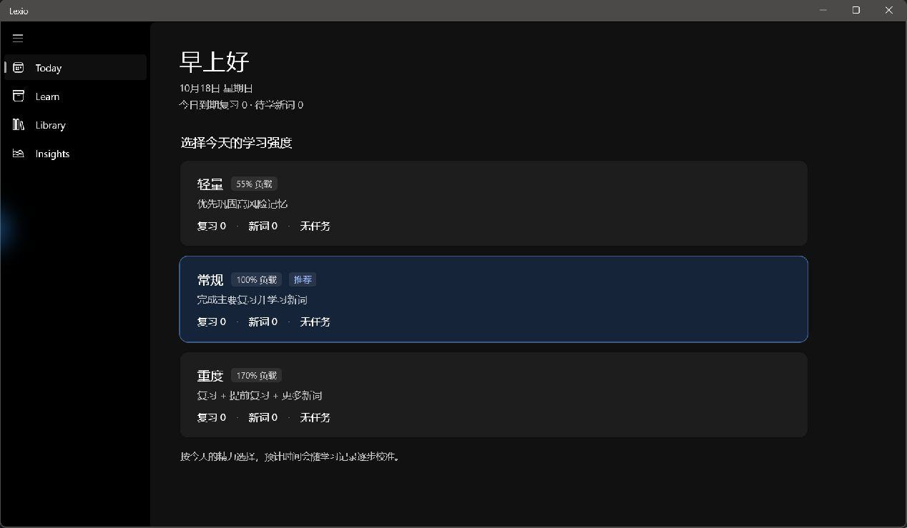
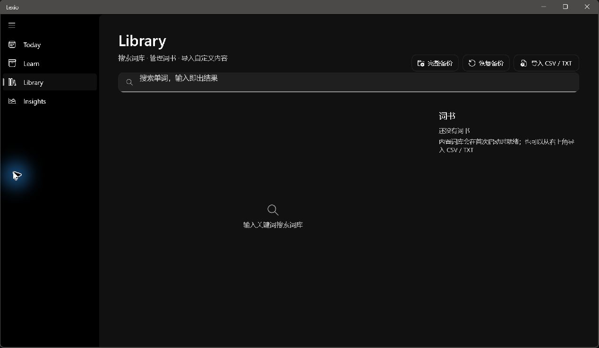
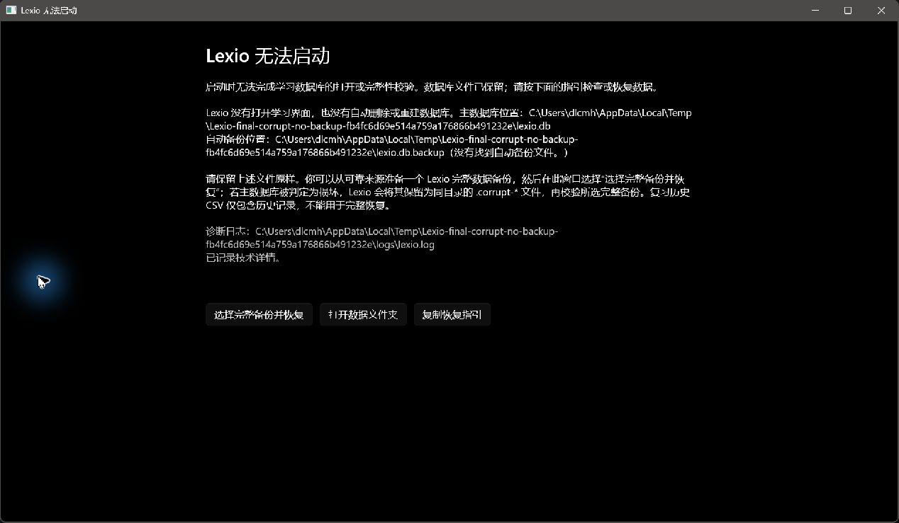
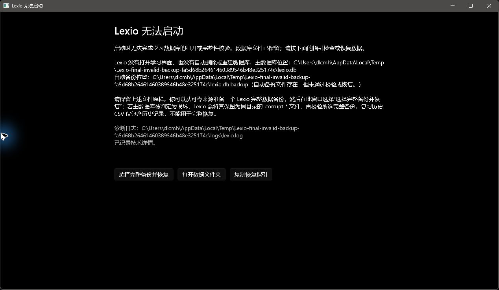

> 历史检查记录；其中“无安装器”和旧 Library 空状态描述已过期。请以 [Lexio 发布阻断项最终验收](release-final-acceptance-2026-10-18.md) 为准。

# Lexio 发布阻断项复验

日期：2026-10-18  
结论：**暂不建议进入 Release Candidate。** 自包含发布文件和数据库启动保护已在当前 Windows 主机实测；安装/升级/卸载及干净 Windows 环境仍未验证。

## Git 与构建

- 分支：`master`；检查时 HEAD：`8b521a7`。
- 工作区原本已有 GLM/Codex 未提交修改。本轮没有重置、清理或提交；既有改动均保留。本轮新增的发布验证、许可证和测试文件也仍未提交。
- Release 构建：通过，0 错误；保留 32 条既有 MVVMTK0045 警告。
- 完整测试：Core **86/86**，App **11/11**，合计 **97/97**。
- 未升级依赖；发布配置显式关闭 AOT 和裁剪。

## P0 阻断项

| 项目 | 状态 | 证据和限制 |
|---|---|---|
| unpackaged 自包含发布 | **本机实测通过；干净系统未验证** | [发布配置](../src/Lexico.App/Properties/PublishProfiles/win-x64-self-contained.pubxml)在不启用 AOT/裁剪的情况下启用自包含 .NET 和 Windows App SDK。独立发布目录：`C:\Users\dlcmh\AppData\Local\Temp\Lexio-publish-delivery-409393c4ec464d57865cedfe6c17e4f2`。包含 345 个文件、221,874,182 字节，含 .NET 10.0.13、Windows App SDK、SQLite 原生库、WinUI XBF/PRI 资源和许可证。受限 PATH、移除 DOTNET_ROOT 环境变量后实际启动成功；运行进程加载的 `coreclr.dll`、`hostfxr.dll`、`hostpolicy.dll` 均来自该发布目录。该主机本身仍安装了 .NET，故不能据此声称干净系统验证通过。 |
| 安装、升级、卸载及保留用户数据 | **未解决 / 未验证** | 未发现 Inno Setup `ISCC.exe` 或 Windows Sandbox。没有可编译的安装器，也没有干净 VM；因此安装、覆盖升级、卸载及卸载时保留 `%LOCALAPPDATA%\Lexio` 均未实测。当前产物是可启动的 xcopy 发布目录，不是安装包。 |
| 数据库损坏和启动恢复提示 | **已解决并实测** | [启动恢复实现](../src/Lexico.Core/Data/AppDatabase.cs)、[错误说明窗口](../src/Lexico.App/Windows/StartupErrorWindow.cs)和[诊断记录](../src/Lexico.App/Services/StartupFailureReporter.cs)。最终发布版在隔离数据目录中完成首次启动、损坏主库且无备份、有效自动备份恢复、无效自动备份拒绝恢复。无备份场景的主库 SHA-256 与启动前一致，未创建自动备份；有效备份场景启动进入主界面并将原损坏文件保留为 `.corrupt-*`；无效备份场景主库与备份 SHA-256 均未改变。错误窗口说明数据库/备份路径、备份状态和恢复步骤，日志包含 SQLite 技术异常。真实界面截图见下方。 |
| 第三方依赖和词库来源 | **发布包合规处理已完成；词库源仍未知** | [THIRD-PARTY-NOTICES.md](../THIRD-PARTY-NOTICES.md) 记录发布依赖版本、来源、许可、署名/再分发条件和用途；发布目录带有 27 个许可证/声明文件。源码中的 `starter-dictionary.json` 来源无法确认，已从发布程序集排除，发布目录中该资源计数为 0。没有发现随包分发的其他词典数据库、音频或发音录音。此处理避免再分发来源不明内容，但发布版首次使用没有内置词库。 |

## P1 完整数据备份与恢复

- 已在 Library 页显示“完整备份”和“恢复备份”入口；实际运行窗口中确认可见。复习历史 CSV 导出与完整 SQLite 数据备份保持区分。
- [备份服务](../src/Lexico.Core/Data/UserDataBackupService.cs)在恢复前创建安全快照，校验备份结构和完整性，失败时尝试从快照回滚；恢复后刷新自动备份。默认数据目录为 `%LOCALAPPDATA%\Lexio`，主库为 `lexio.db`，自动备份为 `lexio.db.backup`，启动时及每 15 分钟尝试更新，错误写入日志。完整备份是数据库快照，覆盖自定义词库、卡片/复习历史和设置；CSV 仅导出复习历史。
- [Core 测试](../tests/Lexico.Core.Tests/UserDataBackupServiceTests.cs)验证词库、学习卡片/复习历史、设置恢复、恢复前快照、自动备份刷新；无效备份测试验证当前数据保留、回滚成功和安全快照存在。上述均使用临时数据库。
- **未验证：** 受限的 PickerHost 窗口无法通过当前 UI 自动化完成文件选择，所以“保存完整备份”与“在 UI 中选文件并恢复”的端到端操作、成功/失败提示尚未实测。自动化测试不能替代这项 UI 验收。
- **文案问题：** 由于发布包没有内置词库，Library 空状态现有文案“内置词库会在首次启动时就绪”不准确。该 UI 文件属于 GLM 页面工作范围，本轮未修改；需由页面负责人调整为导入说明，或在采用可核实来源的数据后再恢复内置词库。

## 截图证据

以下为当前发布目录的真实运行截图，数据库均位于临时隔离目录：

## 进入 RC 前仍需完成

1. 在安装器工具可用的环境中生成并验证安装、升级、卸载流程；确认卸载不删除 `%LOCALAPPDATA%\Lexio`。
2. 在没有 .NET 10 预装的干净 Windows 虚拟机或实体机上安装并启动最终安装包。受限 PATH 的本机测试不能替代这项验证。
3. 通过真实文件选择器完成完整备份保存与恢复操作，确认成功提示、无效文件提示和恢复前数据保护。
4. 更正 Library 空状态的内置词库提示，或先替换成来源和再分发许可明确的数据并重新审查；不要把当前来源不明的 starter JSON 放回发布包。
